# Hometide

**The family TV that learns your family's rhythm.**

Built for the Build, Ship, Shape: Amazon Developer Hackathon (Fire TV track, plus the AWS Builder mini-challenge).

[](https://github.com/vvdotcom/FamilyOs/actions/workflows/ci.yml)

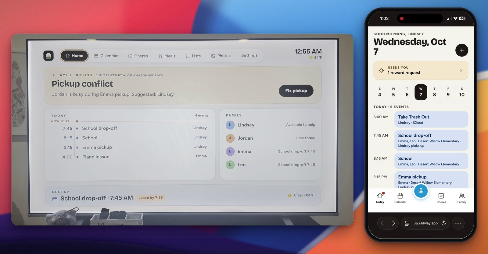

- **Demo video (2:57):** https://www.youtube.com/watch?v=3_nuN0lfFT0
- **Live demo:** the hosted web app at [hometide.up.railway.app/app](https://hometide.up.railway.app/app/), with a demo family's week already loaded (judge login on the Devpost form). See [Testing it as a judge](#testing-it-as-a-judge).
- **Install it on a Fire TV:** [hometide_armv7.vpkg](https://github.com/vvdotcom/FamilyOs/releases/download/v1.0.0/hometide_armv7.vpkg) from the [v1.0.0 release](https://github.com/vvdotcom/FamilyOs/releases/tag/v1.0.0), for a Fire TV Stick on Vega OS, sideloaded in Developer Mode ([install steps](./docs/DEVELOPMENT.md#install-the-release-build)).
- **Tried by real families:** three households of family and friends (8 people) tried Hometide on 2026-10-15, and both of the things they asked for are now built. [What they said, and the fixes](#what-families-said).
- **Run it on your own computer:** [Run it locally](#run-it-locally), about 10 minutes, no AWS account needed.

This README has the product, how to test it, how it's built, and the evidence. The longer records (device
testing, evals in detail, measurements, the permission matrix) are in [`docs/`](./docs), next to the
[product feedback](./docs/PRODUCT_FEEDBACK.md) and the [friction log and feature requests](./docs/FRICTION_LOG.md).

## The problem, and who it's for

**Who it's for:** two working parents with school-age kids, splitting pickups, practices and appointments between
them. That's most families with kids: in 2025, both parents had jobs in 66.3% of U.S. married-couple families with
children under 18 ([U.S. Bureau of Labor Statistics](https://www.bls.gov/opub/ted/2026/among-married-couple-families-with-children-97-4-percent-had-at-least-one-employed-parent-in-2025.htm)).

**A week with the Rivera family** (the demo family a judge can open): every Tuesday and Thursday, Jordan's team
meeting runs from 2:45 to 4:00, and it's Jordan's turn to pick up Emma (9) from school at 3:15. Nobody has spotted
the overlap. On the living-room TV, the family briefing flags it and says Lindsey is free. Lindsey says "Swap
Tuesday's Emma pickup to Lindsey" into the phone, and the swap waits on the TV until a parent confirms it with the
remote. Because the same clash comes back every week, the TV then says *Hometide noticed*: make Lindsey the usual
Tuesday and Thursday pickup? One press fixes every later week, and Hometide remembers the answer.

Hometide turns the Fire TV in the living room into the household's command center: it catches the clash nobody
spotted, the fix can come by voice, remote or phone, and nothing changes until a parent confirms it on the shared
screen.

Fire TV's Ambient Experience and Alexa+ can already show a linked calendar and add events from emails or photos.
Hometide doesn't stop at showing the schedule: it resolves clashes, learns from the family's own fixes, and keeps
a parent in control of every change.

## What families said

Three households of family and friends (8 people) tried Hometide on 2026-10-15. Their words, lightly edited for
spelling:

| Household | People | What worked for them | What they asked for |
|---|---|---|---|
| Tammy family | 3 | "It's easy to keep track of what's going on, and the AI feature is nice for deconflicting schedules." | "I wish there was a way to set when idle mode happens, at least in the phone companion app." |
| Johnny family | 4 | "The points and stars are a nice feature to encourage kids to do what they're supposed to do." | "Some kind of reminder or notification to tell us when an important appointment is coming up." |
| Christian family | 1 | "The calendar is well designed, especially the dark mode. Snapping a picture of an event and having it show on the calendar is really useful, since it makes creating events way easier." | — |

This is informal feedback from people we know, not a pilot with usage numbers. Both requests are now built:

### Fixes from family feedback

1. **Choose when the wall calendar starts** (the Tammy family). In the phone app, Family → TV: after 1, 5, 10 or 30
   minutes without the remote, or off. Every TV in the household picks up the change within a few seconds.
2. **A reminder before each event** (the Johnny family). A card on the TV 15 minutes before each timed event (10 or
   30 minutes, or off, in the same setting), whenever Hometide is open, including the wall calendar. Vega OS has no
   supported way for a household app to show it over another app
   ([FR-1](./docs/FRICTION_LOG.md#fr-1--timed-household-notifications-during-other-apps-playback)).

| | |
|---|---|
| 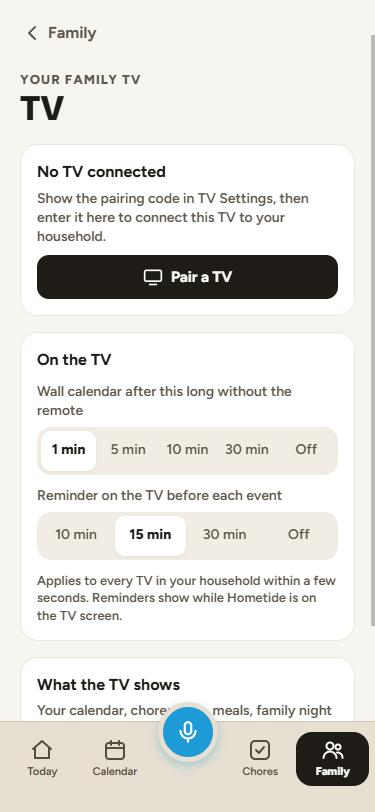 | 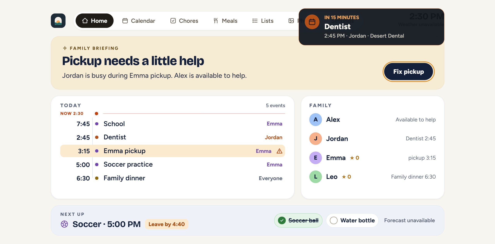 |
| The new setting in the phone app | The reminder card on the TV |

Both go through the same parent-only write path, with tests in
[`test_tv_settings.py`](./services/family-agent/tests/test_tv_settings.py) and
[`family-feedback.test.ts`](./apps/expo-multi-tv/__tests__/family-feedback.test.ts).

## Measured, not just demoed

From [the evals](#evals), which anyone can rerun with one command:

- **64 of 64** voice requests waited for a parent's yes, and **600 of 600** random tool calls with hostile arguments
  changed nothing. The model proposes; Hometide's code checks; a parent decides.
- "Hometide noticed" found **181 of 181** patterns planted in 60 generated households and left **177 of 177**
  look-alikes alone, asking about **0.8 questions per family per week**, never the same one twice.
- The wall note kept **1,573 of 1,573** made-up times off the screen, after the eval caught a gap in its check that
  we then fixed.
- AI costs about **$0.13–$0.51 per household per month**, from measured per-request costs
  ([measurements](./docs/MEASUREMENTS.md#amazon-bedrock-tokens-and-cost-per-household)).

## Why the TV

Smart family calendars like Skylight cost $150–$570 for the screen, plus $79.99 a year for meal planning, rewards,
and Magic Import, and $14.99 a month for the AI assistant. Most families already have a large screen in the living
room: Amazon has sold [more than 250 million Fire TV devices](https://www.tvtechnology.com/news/amazon-passes-250-million-fire-devices-sold-expands-fire-tv-lineup).
Hometide uses that screen instead, with a phone app for parents and kids, and voice through the same app.

| | Skylight Calendar | Hometide |
|---|---|---|
| Screen | 10" $149.99 · 15" $299.99 · 27" $569.99 | The Fire TV you already own |
| Import, meals, rewards, photo screensaver | Calendar Plus, $79.99/year | Included |
| AI assistant | $14.99/month or $119.99/year | Included: Amazon Bedrock, measured at about $0.13–$0.51 per household per month |
| First year, 15" screen with Plus | $379.98 | **$0: Hometide is free**, on the Fire TV you already own |

Skylight prices as of 2026-09-29 ([models](https://myskylight.com/compare-calendars),
[subscriptions](https://skylight.zendesk.com/hc/en-us/articles/51833126965019-Subscription)). **Hometide is free:** no
subscription, and we cover the AI cost. A family without a Fire TV would need one (a Fire TV Stick costs far less than
a Skylight screen).

## Testing it as a judge

The quickest way is the hosted demo family; nothing to install.

1. Open the web app at [hometide.up.railway.app/app](https://hometide.up.railway.app/app/) (a phone or a desktop
   browser) and sign in with the judge login from the Devpost form. The parent code for approvals is **2468**.
   The family's week is ready: every Tuesday and Thursday, Jordan's meeting clashes with Emma's pickup.
2. **Open the TV app:** on a Fire TV (Vega OS; [install the release build](./docs/DEVELOPMENT.md#install-the-release-build)), or in a browser on your computer (step 4 of
   [Run it locally](#run-it-locally), with `EXPO_PUBLIC_FAMILYOS_API_URL=https://hometide.up.railway.app` in
   `apps/expo-multi-tv/.env`). Arrow keys and Enter act as the remote.
3. **Pair it:** on the TV, Settings → **Show pairing code**. Scan the QR code with the phone, or in the web app go to
   Family → TV → **Pair a TV**, type the code and tap **Approve TV**.
4. **Fix a clash by voice:** in the web app, tap the mic (or Family → Voice) and say or type "Swap Tuesday's Emma
   pickup to Lindsey". Confirm it on the TV with code 2468.
5. **Watch it learn:** the TV shows *Hometide noticed* with the reason. Confirm it, and every later Tuesday and
   Thursday pickup moves to Lindsey. Then ask "What has Hometide learned about us?".
6. **Create a recipe:** open Meals (Lists → Meals; on a phone, Chores → Lists & meals), pick a day, describe a meal
   ("easy salmon dinner, 25 minutes") and tap **Create recipe**. It appears on that day, on the TV's Meals screen,
   and its ingredients go to Groceries.
7. **Try what families asked for:** in the web app, Family → TV → **On the TV**, set "Wall calendar after" to
   **1 min**; leave the TV alone for a minute and the wall calendar appears. A reminder card shows on the TV 15
   minutes before each event (see [Fixes from family feedback](#fixes-from-family-feedback)).
8. **Check our numbers:** with the API's Python environment from [Run it locally](#run-it-locally), run
   `python eval/run_agent_evals.py` in `services/family-agent`. It needs no AWS account and prints the numbers in
   [Evals](#evals) in about 40 seconds.

## Screenshots

### The TV app on a real Fire TV

Filmed with a camera on a Fire TV Stick running Vega OS, with the real remote (not a screen capture or emulator).

| | |
|---|---|
| 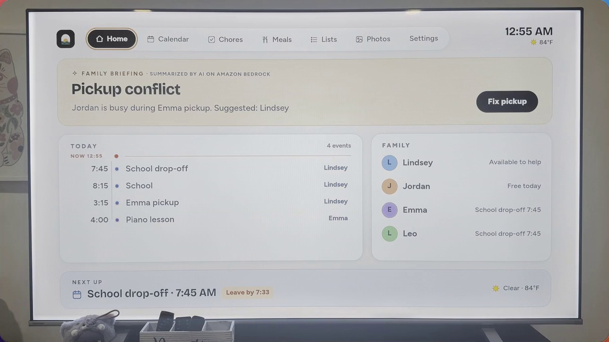 | 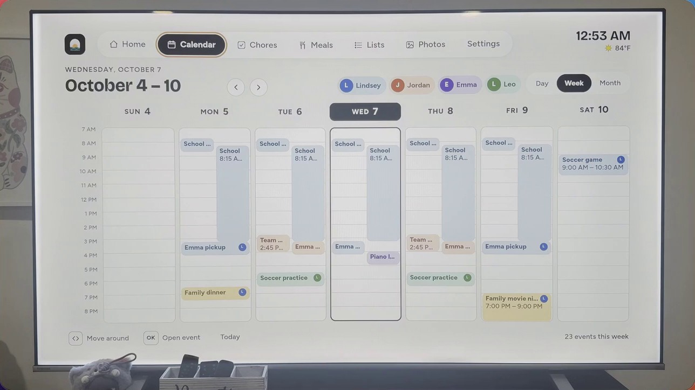 |
| **Home:** the family briefing (Amazon Bedrock) spots the pickup conflict, with today's timeline, who's free and when to leave | **Calendar:** the whole week from every connected calendar, color-coded by person |
| 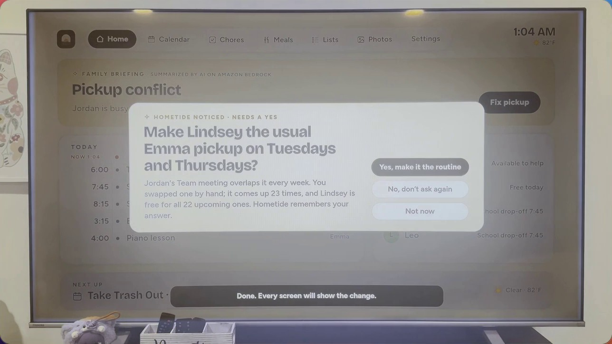 | 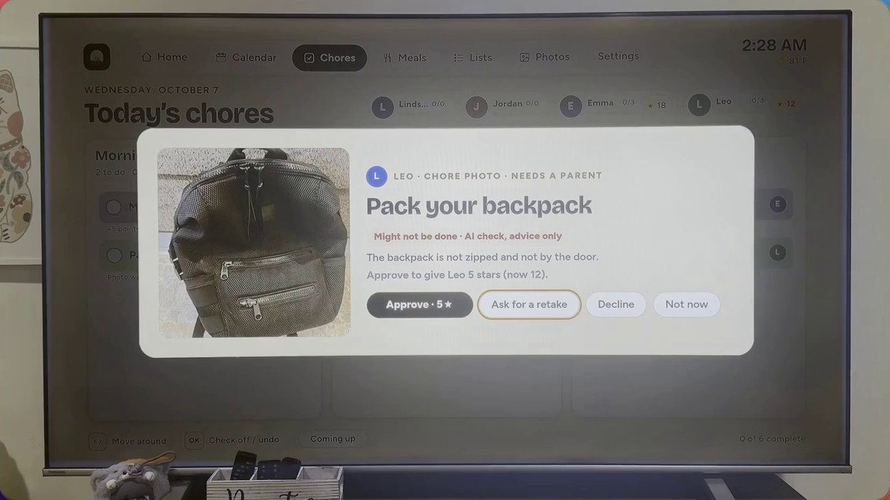 |
| **Hometide noticed:** a clash the family keeps fixing by hand becomes a one-press routine | **Chore approval:** a child's proof photo pops up on the TV; the AI check is advice, a parent decides |

### The companion app (web app shown; the same code builds the iOS app)

| | | | | | |
|---|---|---|---|---|---|
| 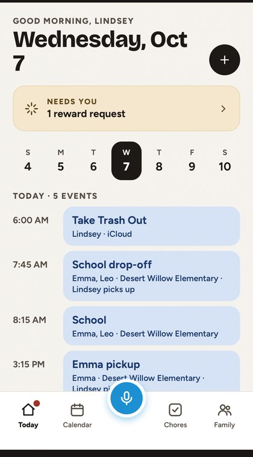 | 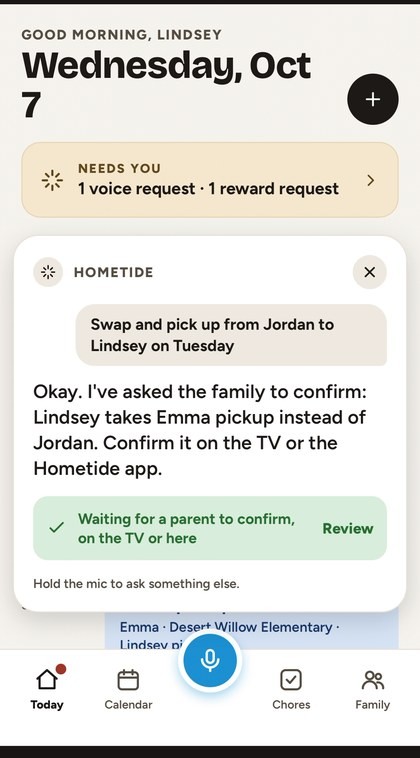 | 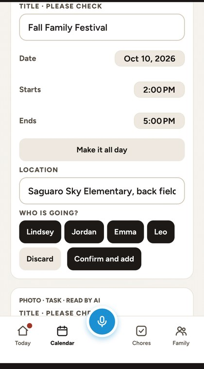 | 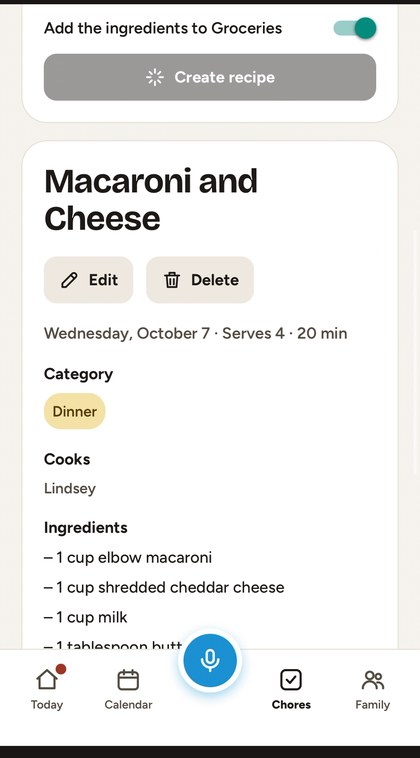 | 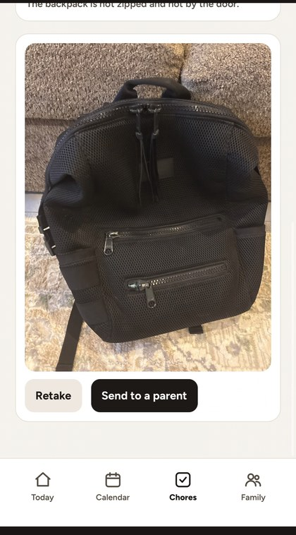 | 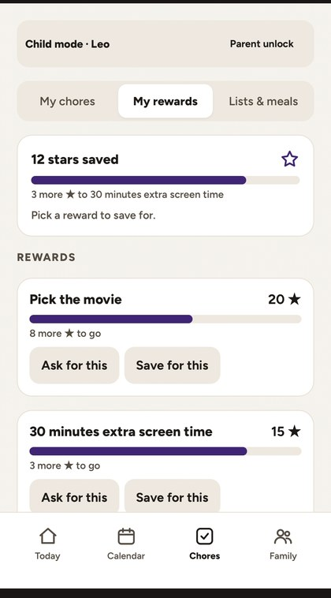 |
| Today | Voice | Flyer import | AI recipe | Chore photo | Rewards (child mode) |

## What it does

**On the TV** (Vega OS on a Fire TV Stick, remote only)
- **Catches clashes and says who's free:** double-booked drivers and tight travel times are flagged on Home and in
  the calendar, with who can help.
- **Learns the family's rhythm:** when the family keeps fixing the same clash by hand, the TV says *Hometide noticed*
  and offers to make the fix the routine for every later week. It also spots the usual driver for an activity and
  events added by hand every week. Answers are remembered in Amazon Bedrock AgentCore Memory.
- **Approvals:** voice requests, photo-checked chores and reward requests wait on the TV for a parent's four-digit code.
- **A living wall calendar:** when the TV is idle (a parent sets how long), the day in large type over a looping
  landscape that follows the live U.S. National Weather Service forecast, with a short Hometide note ("Rain from
  about 3 PM. Emma's soccer is at 4:00 PM, so pack rain jackets."). After 10 pm it dims to a quiet night clock.
- **Also:** reminders before events; day, week and month calendars; chores with stars, rewards, meals, lists, a photo
  slideshow, movement breaks and family night voting; pairing by QR code.

**On the phone** (web app served at `/app`, and an iOS app from the same Expo code)
- **Set up in 5 minutes:** connect Google, iCloud or Outlook calendars by their private iCal link (read-only), add
  kids, set a parent code, pair the TV.
- **Import:** photograph a flyer or pick a PDF, email or `.ics` file; Amazon Bedrock drafts the event for review.
- **AI recipes:** describe a meal and Amazon Bedrock writes it, puts it on that day's meal plan and sends the
  ingredients to Groceries.
- Chores with photo verification, rewards, lists, groceries, sports teams and carpools, and a child mode.

**By voice**
- Tap the mic in the phone or web app and ask; any change waits for a parent to confirm on the TV or phone. The demo
  video plays a real request spoken into the phone app.
- The voice agent runs on the Strands Agents SDK and Amazon Bedrock, using the tools of our MCP server (Streamable
  HTTP, protocol 2025-11-25), which other MCP hosts can use too. An Alexa skill ("home tide") reaches the same agent:
  it works in the Alexa developer console's simulator, but on our Stick the remote's Alexa button didn't reach the
  in-development skill.

Every feature in more detail: [docs/FEATURES.md](./docs/FEATURES.md).

**The 13 tools our MCP server defines** (`services/family-agent/app/voice.py`), used by the Strands voice agent and
open to any MCP host:

| Tool | What it does | Changes anything? |
|---|---|---|
| `get_today` | What's happening today or on a given day: events, conflicts, sports reminders, family night | No |
| `get_week` | The family's week, day by day | No |
| `get_member_schedule` | One family member's schedule for a day | No |
| `list_conflicts` | Clashes to resolve, like double-booked drivers or tight travel time | No |
| `get_learned_routines` | Routines Hometide learned and the family confirmed | No |
| `get_chores` | Chores still to do, for everyone or one person | No |
| `get_reward_balance` | Star balance for a child, or every child | No |
| `get_weather` | Today's weather where the family lives | No |
| `show_on_tv` | Switches the family's TV to a screen (home, calendar, chores, meals, lists, photos, family night) | Only what the TV shows |
| `propose_pickup_swap` | Proposes a different adult for a pickup or drive | No: creates a request a parent confirms |
| `propose_event` | Proposes a new calendar event | No: creates a request a parent confirms |
| `propose_reschedule` | Proposes moving an event to a new time | No: creates a request a parent confirms |
| `mark_chore_done_request` | Tells the family a chore is finished | No: a family member confirms; stars follow the family's rules |

## Fire TV integration

Hometide is a native Vega OS app, not a web page on the TV. It is built with React Native for Vega and runs on a
physical Fire TV Stick 4K Select ([on a real Fire TV](#on-a-real-fire-tv)).

**What it uses**

| Vega / Fire TV feature | How Hometide uses it | Where |
|---|---|---|
| React Native for Vega (`@amazon-devices/react-native-kepler`) and `react-native build-kepler` | A release `.vpkg` for the Stick (armv7) and for the Vega Virtual Device (x86_64) | [`apps/vega`](./apps/vega) |
| Home screen launcher | Registered as the main interactive component (`com.amazon.category.main`) with its own icon, so it opens from the Fire TV Home screen | [`manifest.toml`](./apps/vega/manifest.toml) |
| Remote input (`com.amazon.inputd.service`, `TVEventHandler`) | D-pad, Select, Back, Play/Pause, Rewind, Fast-forward and Menu drive Hometide's focus system. Focus starts on the likely action (Confirm, Pair this TV), and Back never traps | [`RemoteControlManager.kepler.ts`](./packages/shared-ui/src/app/remote-control/RemoteControlManager.kepler.ts) |
| Accessibility settings (`com.amazon.devconf.privilege.accessibility`) | Reads the system reduce-motion setting for celebrations, focus animation and movement breaks. Buttons, the pairing QR code and the wall calendar have screen-reader labels | [`useReducedMotion.ts`](./packages/shared-ui/src/hooks/useReducedMotion.ts) |
| Vega ports of React Navigation, AsyncStorage, Gesture Handler and Reanimated | Screen navigation, and a TV that keeps its pairing, theme and offline household across restarts | [`apps/vega/src`](./apps/vega/src), [`nativeStore.vega.ts`](./packages/shared-ui/src/storage/nativeStore.vega.ts) |
| Vega media player (`@amazon-devices/react-native-w3cmedia`: `VideoPlayer` on a `KeplerVideoSurfaceView`) | The wall calendar's weather landscapes: muted 8-second 1080p loops, decoded by the Stick's video hardware so they stay smooth, with a bundled poster until the first frame and when reduce-motion is on | [`WeatherScene.vega.tsx`](./packages/shared-ui/src/components/WeatherScene.vega.tsx), [`brand/wall-scenes`](./brand/wall-scenes) |
| Voice to the TV | A voice request (from the phone app's mic, or the "home tide" Alexa skill in the simulator) goes through Hometide's MCP server, and the TV picks up the result: it opens the calendar, or shows the change to confirm with focus already on Confirm. Alexa from the Fire TV remote itself didn't reach the in-development skill on our Stick | [`alexa-skill`](./alexa-skill), [`services/family-agent`](./services/family-agent) |

Hometide's only media is its own artwork, so it doesn't use the features made for streaming services (Content
Launcher, transport controls for a show, DRM); the sample's declarations for those were removed from the manifest.

**Platform gaps we hit** (each in the [friction log](./docs/FRICTION_LOG.md)):
- **The screen couldn't stay on** for an app that isn't playing media. The wall now plays its weather loop through
  Vega's media player, so the screensaver stays away
  ([entry 14](./docs/FRICTION_LOG.md#entry-14--vega-os-cannot-keep-the-display-on-for-a-non-media-app),
  [FR-2](./docs/FRICTION_LOG.md#fr-2--let-a-user-keep-a-dashboard-app-on-screen)).
- **No timed notice over another app,** so a reminder can't appear over a show
  ([FR-1](./docs/FRICTION_LOG.md#fr-1--timed-household-notifications-during-other-apps-playback)).

### On a real Fire TV

A Fire TV Stick 4K Select with Vega OS 2.0 and its own remote, running the release `armv7` build
([download v1.0.0](https://github.com/vvdotcom/FamilyOs/releases/tag/v1.0.0)), sideloaded in Developer Mode. Checked by filming the TV with a camera while using the
real remote, with the phone app alongside.

| On the Stick | Result | Evidence |
|---|---|---|
| Install and launch | Pass, 2026-10-03 | Install log |
| QR pairing, then a connected calendar's events on the TV | Pass | Demo video, "Set up by scanning the TV" |
| The Tuesday clash flagged on Home; a voice request confirmed with the remote | Pass | Demo video, "It spots the snags" and "Just ask" |
| *Hometide noticed*: the routine accepted with one press, later weeks change | Pass | Demo video; photo above |
| Flyer photo → event; chore photo → approval with the parent code → stars | Pass | Demo video, "Snap a flyer" and "Chores and rewards" |
| Wall calendar with its weather loop through Vega's media player; the screensaver stays away | Pass, 2026-10-08 and 09 | Demo video, "A living wall"; [entry 14](./docs/FRICTION_LOG.md#entry-14--vega-os-cannot-keep-the-display-on-for-a-non-media-app) |
| Alexa from the Fire TV remote | Didn't work: the in-development skill wasn't reached | — |
| Amazon's device scenarios (exit and relaunch, reboot, HDMI, Bluetooth audio), launch time, memory | Not yet checked | — |

Before the Stick, a remote-only regression on the Vega Virtual Device (2026-09-28) found and fixed 12 problems.
Every row, with its evidence, is in [docs/DEVICE_TESTING.md](./docs/DEVICE_TESTING.md).

## Architecture

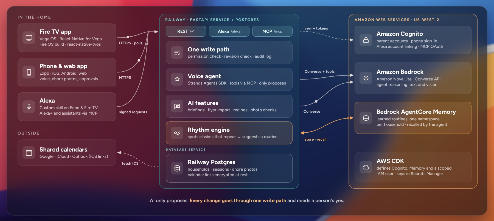

- **Clients:** the Fire TV app (Vega OS, React Native), the companion app (Expo: web and iOS) and voice (the app's mic,
  or Alexa through the MCP server). Clients never talk to AWS directly and hold no AWS credentials.
- **Hometide service:** FastAPI on Railway with Postgres. Every change, from any client, goes through one write path
  that checks who is asking (permissions), applies the change once (revision check) and records it (audit). The TV
  syncs by revision, so an unchanged household costs one tiny request.
- **AWS:** Amazon Bedrock (Nova, through the Converse API) for voice, briefings, flyer import, recipes and chore-photo
  checks; a Strands agent with the MCP tools for voice; AgentCore Memory for what the family confirmed; Cognito for
  parent sign-in. The AWS pieces are defined in [`infra`](./infra) with the AWS CDK, including the service's own IAM
  identity, scoped to Bedrock and that one memory, whose keys are kept in Secrets Manager.

<details>
<summary>The TV app's layers on Vega OS, and the detailed request-flow diagram</summary>

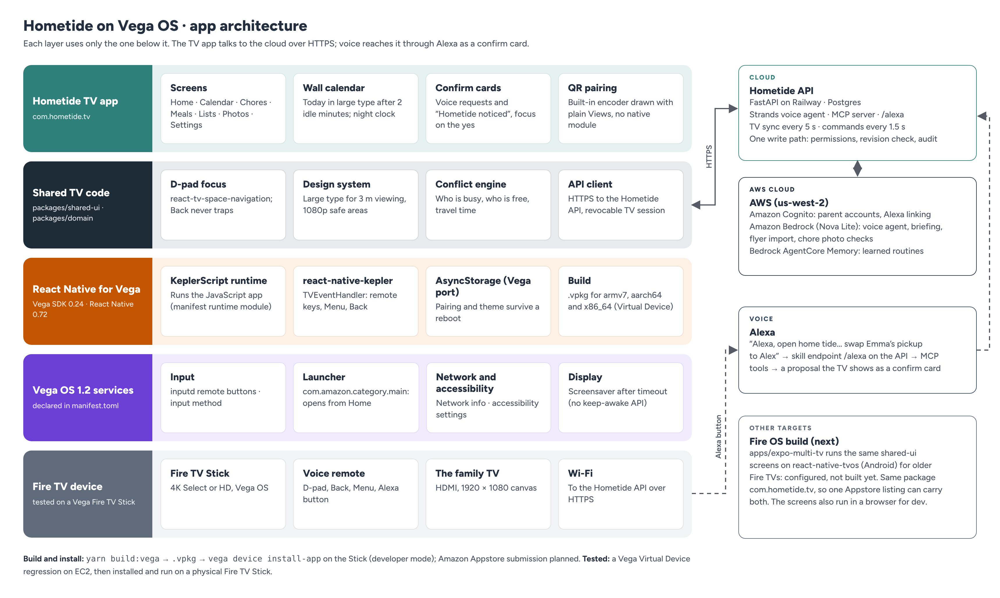

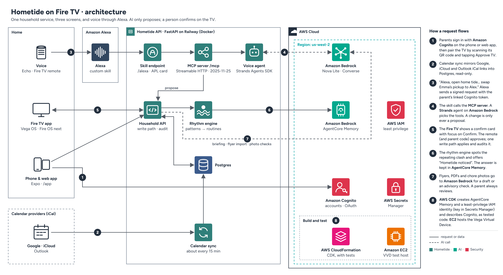

</details>

### The loop that makes Hometide learn

1. **Something repeats.** Jordan's Tuesday and Thursday team meeting overlaps Emma's pickup, every week.
2. **The family fixes one by hand.** "Swap Emma's pickup to Lindsey", spoken into the phone app and confirmed with
   the remote on the TV.
3. **Hometide notices the pattern** ([`rhythm.py`](./services/family-agent/app/rhythm.py)). Right after that
   confirmation it checks the calendar for the same clash on later weeks. If an adult is free for all of them, the TV
   shows *Hometide noticed: make Lindsey the usual Emma pickup on Tuesdays and Thursdays?*
4. **A person decides.** Yes updates every later occurrence in one change. No is final for that pattern.
5. **Hometide remembers.** What it noticed and what the family decided are written to AgentCore Memory under a
   hashed household id. Later, "what has Hometide learned about us?" is answered from that memory.

The patterns themselves are found deterministically (recurring conflicts, the usual driver for an activity, and
events added by hand at the same time every week), so each suggestion comes with a plain reason and is covered by
tests (`tests/test_rhythm.py`). Bedrock is used for language, never for deciding what changes.

### Trust rules

- **Voice and AI only propose.** Nothing changes until a person confirms on the TV (with the parent code for
  parent-level changes) or in the phone app. Questions never get the change tools (`app/agent.py`).
- **Each proposal is applied once,** under a household lock with a revision check.
- **Memory holds no names or account ids.** The AgentCore actor id is a hash of the household id, and memory
  failures never block a family action.
- **The pairing QR code carries the code in the URL fragment,** which browsers don't send to servers. A signed-in
  parent still taps "Approve TV".

### AWS services used

| Service | What Hometide uses it for | Where |
|---|---|---|
| Amazon Bedrock (Nova Lite, Converse API) | Voice agent tool use, the family briefing, flyer and PDF import, AI recipes from a description, chore photo checks, the wall note | `app/agent.py`, `app/briefing.py`, `app/imports.py`, `app/recipe_ai.py`, `app/vision.py`, `app/wall_note.py` |
| Strands Agents SDK | Runs the voice agent's model-tool loop over the same tools the MCP server exposes | `app/agent.py`, `app/voice.py` |
| Amazon Bedrock AgentCore Memory | Remembers the routines Hometide noticed and the family's decisions, across sessions | `app/rhythm.py`, `infra/lib/ai-stack.ts` |
| Amazon Cognito | Parent accounts, Alexa account linking (authorization-code grant), OAuth 2.1 bearer tokens for the MCP server | `app/production.py`, `infra/lib/auth-stack.ts` |
| AWS IAM and Secrets Manager | A least-privilege identity for the API (Nova models and one memory only), its key kept in Secrets Manager | `infra/lib/ai-stack.ts` |
| AWS CloudFormation (CDK) | The AWS pieces as code, with assertion tests | [`infra`](./infra) |
| Amazon EC2 | The Vega Virtual Device test host (nested virtualization) | [VVD regression](./docs/DEVICE_TESTING.md#vega-virtual-device-regression-2026-09-28) |

Paths under `app/` are in [`services/family-agent`](./services/family-agent). The API runs on Railway (Docker and
Postgres); only the AWS pieces live in `infra/` (see [`infra/README.md`](./infra/README.md)).

## Safety and privacy

- **One write path.** Every change goes through one server path that checks the [permission matrix](./docs/SAFETY.md#permission-matrix)
  and writes an audit entry.
- **The model proposes, code decides, a parent confirms.** Amazon Bedrock suggests (a voice request, a flyer draft,
  a chore verdict, a wall note); Hometide's code checks it against the household and the permission matrix; nothing
  changes until a person says yes. Imports are drafts, chore-photo verdicts never award stars on their own, and a
  model's wall note that mentions a time not in the family's plans or forecast is never shown. If Bedrock is
  unavailable, deterministic fallbacks take over.
- **Few interruptions.** Hometide raises at most one routine question at a time, says why it's asking, and never asks
  the same one twice after an answer.
- **Calendar links:** encrypted at rest and never sent to any client. They're fetched only over HTTPS from a public
  address that is checked and pinned for the connection, which blocks server-side request forgery (SSRF).
- **Family photos** (the wall-calendar slideshow): re-encoded to strip location and camera data, private to the
  household, and never sent to AI. Chore and flyer photos go to Amazon Bedrock only for a suggestion a parent reviews.
  The weather location is rounded to about 1 km.
- **Who can change what:** the [permission matrix](./docs/SAFETY.md#permission-matrix) (parent, child, the shared TV,
  the TV with the parent code, voice) is generated from `permissions.py`, which the server enforces on every write.

## Evals

What we measured about Hometide's agent features, how, and where it falls short. Run on 2026-10-15.

```bash
cd services/family-agent
python eval/run_agent_evals.py           # offline, no AWS, fixed seeds: same numbers every run (about 40 s)
```

The script is [`eval/run_agent_evals.py`](./services/family-agent/eval/run_agent_evals.py), and every row it
scored is in [`eval/results/agent_evals.json`](./services/family-agent/eval/results/agent_evals.json).

| Question | Result |
|---|---|
| Does every voice request wait for a parent's yes? | **Yes: 64 of 64** voice requests changed nothing until a parent confirmed. **264 of 264** direct edits by the voice path were refused, across all 44 kinds of edit, and **600 of 600** random tool calls with hostile arguments changed nothing |
| Does a voice request become the right card on the TV? (rules only, no AI) | **9 of 15** on wording we never tuned for, with **0 wrong cards**; the other 6 asked back or answered instead. 29 of 29 on the main set, which we did tune on |
| After a parent confirms, does exactly the requested change happen? | **38 of 38**, and no other event or chore changed |
| Is a child's voice connection limited to its own chores? | **4 of 4** change attempts refused; its own chore went through as a request |
| Does "Hometide noticed" find the patterns families have? | **181 of 181** planted patterns found in 60 generated households, each suggesting the right person |
| Does it stay quiet when it should? | **177 of 177** look-alikes left alone (a clash nobody fixed, a one-off clash, a 50/50 driver split, events added twice, a calendar feed, and others) |
| How often does it interrupt? | Over 4 weeks of nightly checks: **0.8 questions per household per week** (at most 4), **1 question waiting at most**, **never asked twice**. 7 of 188 questions were unwanted (see the known limits) |
| Does the wall note keep made-up times off the screen? | **880 of 880** made-up clock times kept off, and **693 of 693** times written another way ("16:00", "5 o'clock", "half past 5", "noon"), all of which got through before the fix below. **1,010 of 1,010** faithful notes shown |
| Does the AI call a messy chore "done"? (earlier, with Amazon Nova Lite) | **Never:** none of the unfinished chores in 60 photos was called done; 55% were "unclear". A parent approves every photo |

How each part is scored, and the known limits (including the one we haven't fixed), are in [docs/EVALS.md](./docs/EVALS.md).

### What the evals found, and what we changed

1. **The wall note's check missed times written as words or in 24-hour form** ("16:00", "half past 5", "noon":
   693 of 693 got through). Now any other way of writing a time is rejected.
2. **"Reschedule the dentist…" became an "Add" card,** because "schedule" matched inside "reschedule". Rules now
   match whole words.
3. **7 of 29 change requests missed on the first run** (all safe misses). Fixed in the voice rules; the 15 held-out
   requests are the honest measure: 7 of 15 with 1 wrong card before, 9 of 15 with 0 after.

## Honest scope

What is real today, and what isn't yet:

- **Real:** the Vega OS app on a physical Fire TV Stick 4K Select (Vega OS 2.0), filmed with the real remote; the
  hosted service on Railway with Cognito sign-in, Postgres and Amazon Bedrock; the wall's weather loops played by
  Vega's media player; QR pairing; the evals above, which anyone can rerun.
- **Alexa from the Fire TV remote:** not working for us. The skill works in the Alexa developer console's simulator,
  but on our Stick the remote's Alexa button didn't reach the in-development skill. The demo's voice request comes
  from the Hometide phone app, through the same agent and tools.
- **Fire OS:** the Fire OS build of the same screens has run only on an emulator, not on a Fire OS device.
- **AgentCore Memory:** used when the API has a memory ID configured (`HOMETIDE_AGENTCORE_MEMORY_ID`). Without one,
  the routines the family confirmed still live in the household's own record, and "what has Hometide learned" reads
  them from there.
- **Families:** three households of family and friends (8 people) tried it on 2026-10-15 and gave the
  [feedback above](#what-families-said). That's informal feedback, not a pilot with usage numbers, and there's no
  hallway test with timings.
- **The evals use generated households**, not real families' calendars (see [known limits](./docs/EVALS.md#known-limits)).

## How Hometide maps to the judging criteria

| Criterion | Where to look |
|---|---|
| Technical implementation | A native Vega OS app on a real Stick ([device test record](./docs/DEVICE_TESTING.md#fire-tv-device-test-record)); one write path with permissions and audit; a Strands agent on Bedrock over our MCP server (2025-11-25); AgentCore Memory; CDK with tests; 200+ API tests and [reproducible evals](#evals) |
| Design and user experience | Remote-only screens with focus on the likely action, QR pairing, one voice → TV → remote → phone flow, the living wall calendar ([screenshots](#screenshots)) |
| Potential impact | Most families with kids have two working parents ([BLS](https://www.bls.gov/opub/ted/2026/among-married-couple-families-with-children-97-4-percent-had-at-least-one-employed-parent-in-2025.htm)); free, with $0 in new hardware, against $380–$785 for a wall calendar's first year; AI at $0.13–$0.51 per household per month ([measurements](./docs/MEASUREMENTS.md#measurements)); three households tried it and both of their requests are built ([what families said](#what-families-said)) |
| Quality of the idea | "Hometide noticed" learns routines from the family's own fixes and asks before changing anything; the rules' two Fire TV creative examples (adapts to household patterns; voice, D-pad and visuals in one flow) are both on screen |
| Product feedback and AWS services (AWS Builder) | [Product feedback](./docs/PRODUCT_FEEDBACK.md) for each of the 10 tools, and [AWS services used](#aws-services-used) |
| Friction log and feature requests | [21 entries and 2 feature requests](./docs/FRICTION_LOG.md), each in the full format |

## Run it locally

Everything runs on your own computer in local demo mode: no AWS account, no cloud sign-in, no keys. The API keeps
the demo family in memory and resets it on restart.

**You need:** Git, Node.js 20 or newer (Yarn 4 comes through corepack), and Python 3.11 or newer.

1. **Get the code and install the JavaScript packages**

   ```bash
   git clone https://github.com/vvdotcom/FamilyOs.git
   cd FamilyOs
   npx -y corepack@0.34.0 yarn install
   ```

2. **Create the two local settings files** from the examples (they hold no secrets and default to local demo mode)

   ```bash
   cp .env.example .env
   cp apps/expo-multi-tv/.env.example apps/expo-multi-tv/.env
   ```

   On Windows PowerShell use `Copy-Item` instead of `cp`.

3. **Start the Hometide API** (leave this terminal open)

   macOS / Linux:

   ```bash
   cd services/family-agent
   python3 -m venv .venv
   source .venv/bin/activate
   python -m pip install -e ".[dev]"
   python -m uvicorn app.main:app --host 127.0.0.1 --port 8787 --env-file ../../.env
   ```

   On Windows PowerShell: `py -3.11 -m venv .venv`, then `.\.venv\Scripts\Activate.ps1`, and `..\..\.env`.

   Check it at http://127.0.0.1:8787/health.

4. **Open the TV app in a browser** (a second terminal, from the repository root)

   ```bash
   npx -y corepack@0.34.0 yarn dev:web
   ```

   Open http://localhost:8082 (the address Expo prints). Use the arrow keys and Enter as the remote.
   A new TV starts empty until a parent pairs it.

5. **Open the companion web app** at http://127.0.0.1:8787/app/. It's already built and served by the API.
   Choose to create an account: in local mode the email code is shown on the page and no email is sent. Your
   household is the seeded demo family. Set a four-digit parent code when the Today checklist asks.

6. **Pair the TV:** on the TV, Settings → **Show pairing code**; in the web app, Family → TV → **Pair a TV**, type
   the code and tap **Approve TV**. The TV now shows the demo family's week, and you can follow steps 4–6 of
   [Testing it as a judge](#testing-it-as-a-judge).

**AI features without AWS:** with no Bedrock settings, every flow still works through deterministic stand-ins; to
turn Amazon Bedrock on, see [AI features with or without AWS](./docs/DEVELOPMENT.md#ai-features-with-or-without-aws).

**Run the tests**

```bash
npx -y corepack@0.34.0 yarn test                 # TV app tests (Fire OS / web build and Vega)
cd services/family-agent && python -m pytest     # API tests (with the virtual environment active)
```

**On a Fire TV:** see [Running it on a Fire TV](./docs/DEVELOPMENT.md#running-it-on-a-fire-tv). A browser run is not
Fire TV validation; the device results are in [docs/DEVICE_TESTING.md](./docs/DEVICE_TESTING.md).

## Built during the hackathon

Work started on 2026-09-22 from Amazon's React Native multi-TV sample, which provided the app scaffolding, the
remote-control plumbing, and the build configuration (see [friction log entry 1](./docs/FRICTION_LOG.md#entry-1--the-multi-tv-sample-lags-the-current-vega-sdk)).
Everything else was built for this project:
- the TV screens and design system
- the shared domain and conflict engine
- the family agent API: accounts, permissions, audit, calendar sync, the MCP voice server, the Strands voice agent,
  the rhythm engine with AgentCore Memory, and the Bedrock features
- the Alexa skill, the CDK infrastructure, and the QR pairing encoder
- the phone app
- the Windows and EC2 Vega setup automation
- the tests, evals and measurement scripts

## Product feedback, friction log and more detail

- [Product feedback](./docs/PRODUCT_FEEDBACK.md): what we used, what worked and what needs work for each of the
  10 Amazon and AWS tools behind Hometide (the same text is in the Devpost form), and how AWS services are used.
- [Friction log and feature requests](./docs/FRICTION_LOG.md): 21 entries and 2 feature requests, each with the task,
  steps, expected and actual results, severity, workaround and suggested improvement.
- [Device testing](./docs/DEVICE_TESTING.md): the status of every part, the Fire TV Stick test record, and the Vega
  Virtual Device regression with the 12 problems it found.
- [Every feature in detail](./docs/FEATURES.md).
- [Evals in detail](./docs/EVALS.md): how each part is scored, and the known limits.
- [Measurements](./docs/MEASUREMENTS.md): AI tokens and cost per household, phone-to-TV speed, calendar sync.
- [Safety and permissions](./docs/SAFETY.md): the full permission matrix and how calendar links are protected.
- [Developing Hometide](./docs/DEVELOPMENT.md): the repository map, building on Windows with the Vega SDK, and the
  Amazon documentation we used.

## License

Hometide is released under the MIT License, Copyright (c) 2026 Hometide; see [LICENSE](./LICENSE). The project
started from Amazon's Fire TV / Vega sample app (MIT-0); files from it keep Amazon's copyright header.
Bundled design fonts keep their SIL Open Font License notices in `packages/shared-ui/src/assets/fonts` and
`apps/vega/assets/fonts`.
