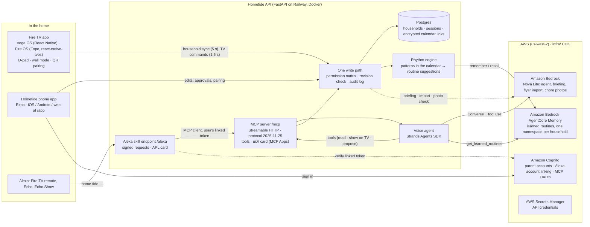

# Hometide architecture

Hometide is one household service with three screens (Fire TV, phone, web) and two voice doors (the Alexa skill
and an MCP server for Alexa+ and other assistants). Every change, from any of them, goes through one write path
that checks who is asking, applies the change once, and records it.

Both images are rendered by `docs/images/src/architecture.py` and `docs/images/src/vega.py`. The same structure in
text form:

## The loop that makes Hometide learn

1. **Something repeats.** Jordan's Tuesday and Thursday team meeting overlaps Emma's pickup, every week.
2. **The family fixes one by hand.** "Alexa, open home tide… swap Emma's pickup to Lindsey", confirmed with the
   remote on the TV.
3. **Hometide notices the pattern** (`services/family-agent/app/rhythm.py`). Right after that confirmation it
   checks the calendar for the same clash on later weeks. If an adult is free for all of them, the TV shows
   *Hometide noticed: make Lindsey the usual Emma pickup on Tuesdays and Thursdays?*
4. **A person decides.** Yes updates every later occurrence in one change. No is final for that pattern.
5. **Hometide remembers.** What it noticed and what the family decided are written to AgentCore Memory under a
   hashed household id. Later, "what has Hometide learned about us?" is answered from that memory.

The patterns themselves are found deterministically (recurring conflicts, the usual driver for an activity, and
events added by hand at the same time every week), so each suggestion comes with a plain reason and is covered by
tests (`tests/test_rhythm.py`). Bedrock is used for language, never for deciding what changes.

## Trust rules

- **Voice and AI only propose.** Nothing changes until a person confirms on the TV (with the parent code for
  parent-level changes) or in the phone app. Questions never get the change tools (`app/agent.py`).
- **Each proposal is applied once,** under a household lock with a revision check.
- **Memory holds no names or account ids.** The AgentCore actor id is a hash of the household id, and memory
  failures never block a family action.
- **The pairing QR code carries the code in the URL fragment,** which browsers don't send to servers. A signed-in
  parent still taps "Approve TV".

## AWS services used

| Service | What Hometide uses it for | Where |
|---|---|---|
| Amazon Bedrock (Nova Lite, Converse API) | Voice agent tool use, the family briefing, flyer and PDF import, chore photo checks | `app/agent.py`, `app/briefing.py`, `app/imports.py`, `app/vision.py` |
| Strands Agents SDK | Runs the voice agent's model-tool loop over the same tools the MCP server exposes | `app/agent.py`, `app/voice.py` |
| Amazon Bedrock AgentCore Memory | Remembers the routines Hometide noticed and the family's decisions, across sessions | `app/rhythm.py`, `infra/lib/ai-stack.ts` |
| Amazon Cognito | Parent accounts, Alexa account linking (authorization-code grant), OAuth 2.1 bearer tokens for the MCP server | `app/production.py`, `infra/lib/auth-stack.ts` |
| AWS IAM and Secrets Manager | A least-privilege identity for the API (Nova models and one memory only), its key kept in Secrets Manager | `infra/lib/ai-stack.ts` |
| AWS CloudFormation (CDK) | The AWS pieces as code, with assertion tests | `infra/` |
| Amazon EC2 | The Vega Virtual Device test host (nested virtualization) | `docs/VEGA_VVD_TEST_REPORT.md` |

The API runs on Railway (Docker and Postgres). Only the AWS pieces live in `infra/`; see `infra/README.md`.
